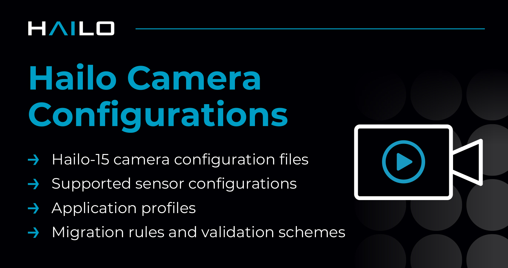

Hailo Camera Configurations
===========================

.. |license| image:: https://img.shields.io/badge/License-MIT-yellow.svg
   :target: https://github.com/hailo-ai/hailo-camera-configurations/blob/master/LICENSE
   :alt: License: LGPL v2.1
   :height: 20

|license|

----

Overview
--------
The Hailo Camera Configurations repository provides camera configurations for Hailo-15 devices, including sensor settings, image quality parameters, and application profiles.

Highlights
----------
* Camera configuration files for Hailo-15H and Hailo-15L devices
* Sensor configurations for various camera modules (Examples: IMX678, IMX675, IMX664, IMX715, IMX307, IMX662)
* Application profiles (daylight, HDR, lowlight, IR)
* Migration rules and validation schemas

Path references in configuration files
--------------------------------------
Path-valued JSON keys may be **absolute** (``/etc/imaging/cfg/...``) or
**relative to the file containing them**. Relative refs are anchored at the
parent directory of that file. Absolute and relative entries can be mixed
freely.

Both forms are accepted for:

* ``.json`` sub-config refs (``application_settings``, ``sensor_config``,
  ``iq_settings``, ``stabilizer_settings``, per-stream ``encoding`` / ``osd`` /
  ``masking``, etc.).
* ``sensor_calib_path`` (dewarp).
* ``backup_folder_path`` (medialib_config). The runtime target
  ``/etc/imaging/cfg/backups/<name>`` is created on the DUT, so it has no
  source-tree counterpart.

Always absolute (external resources outside the cfg tree):
``eis_config_path``, ``network_path``.

Use ``tools/internal/convert_abs_to_rel.py`` to convert absolute refs under
``configurations_tree/cfg/`` to relative form.

Further Reading
---------------
The Hailo-15 is supported by a rich ecosystem of tools and libraries. To fully leverage these resources, visit the
`Hailo Developer Zone <https://hailo.ai/developer-zone/documentation/>`_.
